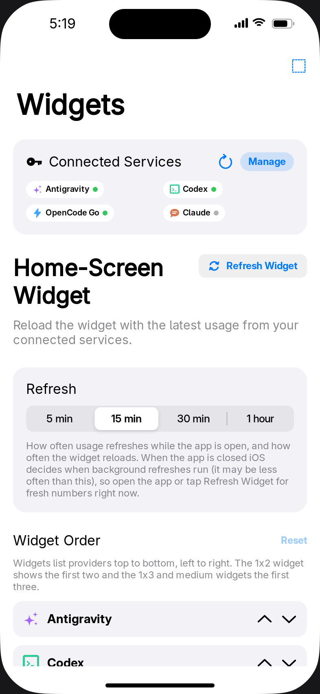
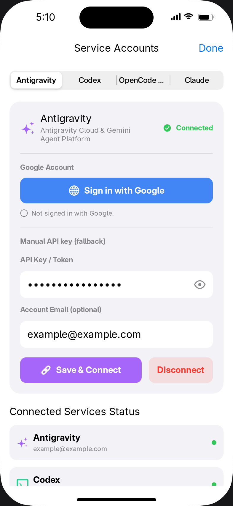
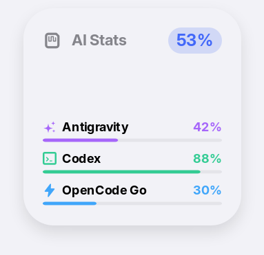
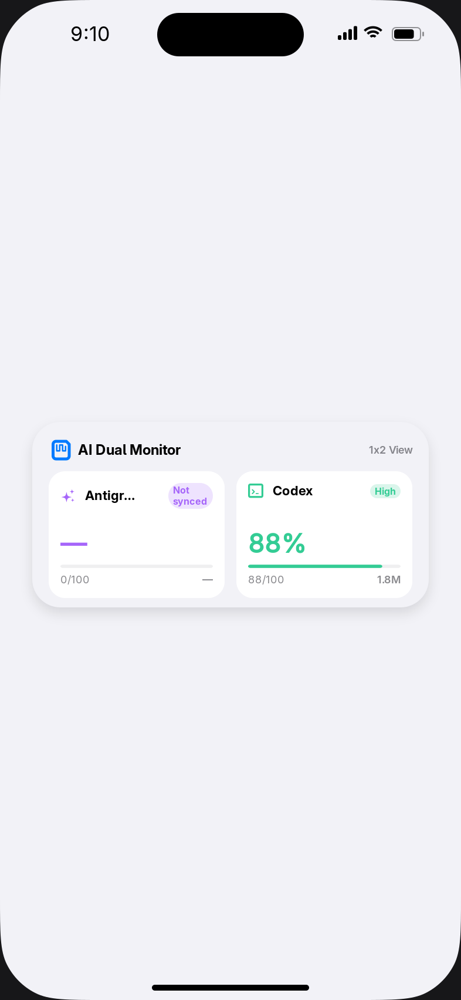
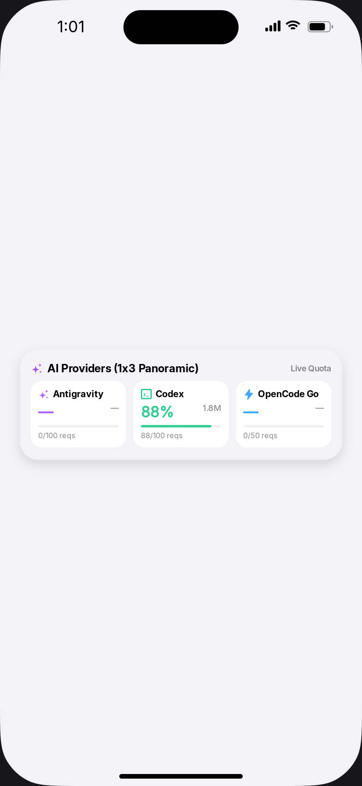
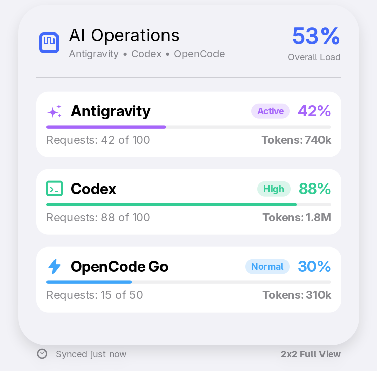

# slopWidget

A native iOS app and home-screen widget that tracks your AI coding-assistant
usage across **Antigravity**, **Codex (ChatGPT)**, **OpenCode Go**, and
**Claude** — in one place, on the home screen, without opening the app.

Built with SwiftUI + WidgetKit, cross-compiled on Linux with
[isim](https://github.com/kolabs-dev/isim) and [xtool](https://github.com/xtool-org/xtool).



## What it does

- **One dashboard** for four providers: Antigravity, Codex (OpenAI),
  OpenCode Go, and Claude — each with a progress bar, percentage, status, and token detail.
- **Home-screen widgets** in four sizes (small 1×1, medium 1×2, large 1×3,
  and 2×2) plus lock-screen circular/rectangular accessories.
- **Interactive widget taps**: tapping the OpenCode Go percentage cycles the
  displayed window (rolling → weekly → monthly) **inline**, without launching
  the app.
- **Real usage data only**: no fabricated request counts. Providers that don't
  report a quota (such as Antigravity) show `—` and are excluded from the
  average, instead of a misleading `100/100`.
- **Sign in with…** for each provider:
  - **Codex**: ChatGPT OAuth (PKCE + loopback callback) plus manual token.
  - **Antigravity**: Google OAuth (PKCE + loopback) plus manual API key.
  - **OpenCode Go**: OpenCode device authorization grant plus manual token.
  - **Claude**: paste a Claude Code OAuth access token (needs the `user:profile`
    scope). Usage (5-hour and weekly windows, whichever is higher) comes from
    Anthropic's undocumented `/api/oauth/usage` endpoint, so it may change. There
    is no in-app Claude sign-in yet.
- **Reorderable widgets**: use the up/down arrows under **Widget Order** in the
  app to choose which provider comes first. The order is shared with the widget
  and applies to every size; the 1x2 shows the first two providers, and the
  1x3 and medium widgets the first three.
- **Shared app/widget state** via a Keychain access group (free provisioning
  has no App Groups), so the widget reflects the latest fetch.
- **Manual refresh** button and 15-minute timeline reloads.

### Dashboard


The dashboard lists every provider with its usage bar, percentage, and status.
The top capsule shows the average across providers that actually report a
number.

### Login sheet



Each provider has its own sign-in flow (OAuth or manual token), plus logout and
endpoint configuration, all in one sheet.

### Widgets

| 1×1 (small) | 1×2 (medium) |
|---|---|
|  |  |

| 1×3 (large) | 2×2 |
|---|---|
|  |  |

Tapping the OpenCode Go percentage on any widget cycles its window
(rolling → weekly → monthly) in place.

## Project structure

- **[Package.swift](Package.swift)**: Swift Package Manager manifest defining
  the `slopWidget` app target, `slopWidgetExtension` WidgetKit target, and
  `slopWidgetTests` test suite (iOS 17+, macOS 14+).
- **[xtool.yml](xtool.yml)**: Configuration for `xtool` — bundle ID, Info.plist,
  resources (copies `AppIntentsMetadata/` to the app bundle root), and the
  widget extension.
- **[slopWidget-Info.plist](slopWidget-Info.plist)**: Registers the `slopwidget`
  URL scheme (deep-link fallback).
- **[slopWidget/](slopWidget/)**: Application source code.
  - `slopWidgetApp.swift`: App scene lifecycle.
  - `ContentView.swift`: Dashboard and live widget previews.
  - `AuthManager.swift`: Centralized `@MainActor` credential storage and state
    for all three providers.
  - `LoginSheetView.swift`: Account management sheet.
  - `ChatGPTOAuth*.swift`, `AntigravityOAuth*.swift`, `OpenCodeOAuth*.swift`:
    per-provider OAuth/device flows and Keychain storage.
  - `ChatGPTUsageService.swift`, `OpenCodeUsageService.swift`: Usage fetch
    clients (OpenCode uses the private `/zen/go/v1/usage` endpoint).
  - `CycleOpenCodeMeterIntent.swift`: AppIntent that cycles the OpenCode window
    (kept alive at link time so widget taps resolve).
  - `UsageSnapshot.swift`: Shared snapshot model published to the widget.
- **[slopWidgetExtension/](slopWidgetExtension/)**: WidgetKit extension.
  - `slopWidgetExtension.swift`: Widget bundle, timeline provider, views for
    every size, and the interactive tap button.
  - `UsageSnapshot.swift`: Widget-side copy of the shared snapshot.
- **[AppIntentsMetadata/](AppIntentsMetadata/)**: Build-time App Intents metadata
  required for interactive widget taps.
- **[scripts/update-appintents-metadata.sh](scripts/update-appintents-metadata.sh)**:
  Linux replacement for Xcode's `appintentsmetadataprocessor`.
- **[Tests/slopWidgetTests/](Tests/slopWidgetTests/)**: 89-test suite.
- **[.github/workflows/test.yml](.github/workflows/test.yml)**: CI test automation.

## Antigravity "Sign in with Google"

The Antigravity tab supports a real Google OAuth 2.0 Authorization Code + PKCE
flow in addition to the manual API-key fallback.

- **Client ID**: `1071006060591-tmhssin2h21lcre235vtolojh4g403ep.apps.googleusercontent.com`
- **Redirect**: `http://127.0.0.1:<ephemeral-port>/` (loopback listener)
- **Scopes**: `cloud-platform`, `userinfo.email`, `aicode`

Values verified from the Antigravity ACP server 1.3.0. The client secret belongs
to Google's public installed-application client and is shipped with the
Antigravity CLI; it is not a user credential. The app stores only the resulting
access/refresh tokens, in a Keychain item separate from the other providers.

To use a different Google client, set `AntigravityGoogleOAuthClientID` (and
optionally `AntigravityGoogleOAuthClientSecret`) in the app's Info.plist. An
empty client ID disables the flow.

## OpenCode Go authentication

The OpenCode Go tab offers **Sign in with OpenCode**, using OpenCode Console's
OAuth 2.0 device authorization grant (verified against `opencode` v2.2.0):

| Setting | Value |
| --- | --- |
| Server | `https://opencode.ai/console` |
| Client ID | `opencode-cli` |
| Device code | `POST /auth/device/code` |
| Token / refresh | `POST /auth/device/token` |
| Account / orgs | `GET /api/user`, `GET /api/orgs` |
| Usage | `GET /zen/go/v1/usage` (Bearer + `x-opencode-org-id`) |

Access/refresh tokens are stored in a Keychain item
(`com.example.slopWidget.opencode`) separate from the other providers.

## Testing

### Run Tests Locally (isim)
```bash
isim test -package-path . -scheme slopWidget
```

### Run Tests via GitHub Actions
The workflow in `.github/workflows/test.yml` runs on push/PR.

## Build & deploy

### iOS Simulator (isim)
```bash
xtool dev generate-xcode-project
isim build -workspace xtool/slopWidget.xcworkspace -scheme slopWidget-App -o build
isim run build/slopWidget-App.app
```

### Physical iPhone (xtool)
With your iPhone connected via USB (trusted):
```bash
xtool dev run -u <DEVICE_UDID> --usb
```
`xtool` builds the app and widget extension, signs them with your Apple ID
certificate, and installs them. Regenerate the App Intents metadata first if you
changed `CycleOpenCodeMeterIntent.swift`:
```bash
./scripts/update-appintents-metadata.sh
```

### Regenerating screenshots

Screenshots are captured from the live app previews using isim:

```bash
./scripts/regenerate-screenshots.sh
```

This requires isim and xtool (see build instructions). A best-effort GitHub Action
(`.github/workflows/screenshots.yml`) attempts the same on release, but hosted
Linux runners lack the Xcode SDK that xtool needs, so regeneration normally
happens locally.

## Interactive widget taps

iOS only runs a widget tap if the app bundle ships
`Metadata.appintents/extract.actionsdata`, which Xcode normally produces with
`appintentsmetadataprocessor` (macOS-only). This project ships a
pre-generated copy under `AppIntentsMetadata/` and copies it to the bundle root
via `xtool.yml`'s `resources:`. Regenerate after editing the intent:

```bash
./scripts/update-appintents-metadata.sh
```
